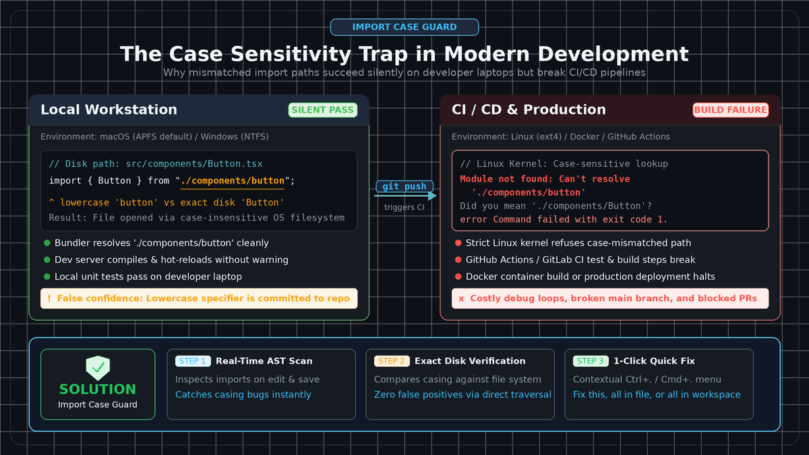
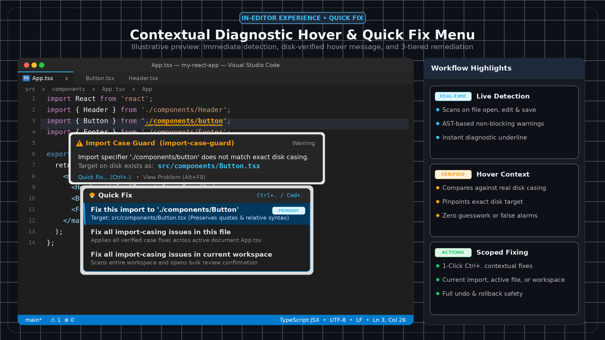
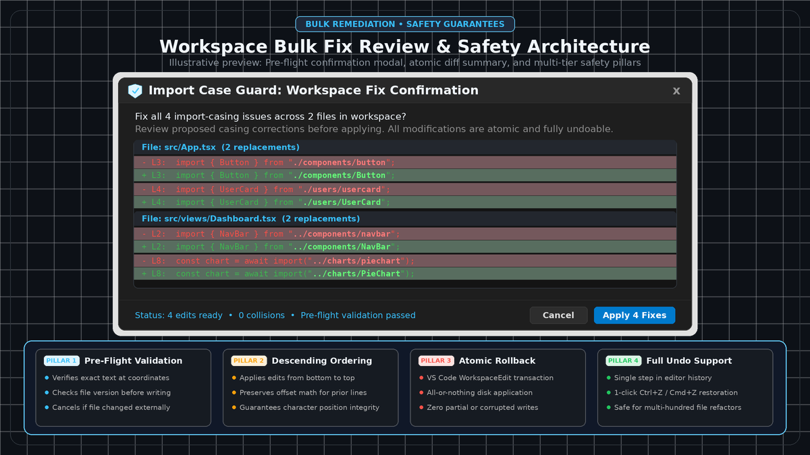

# Import Case Guard

**Import Case Guard** is a lightweight, local-only VS Code extension that catches local relative import-path and configured path alias casing mistakes that may work on case-insensitive filesystems (such as macOS and Windows) but fail on case-sensitive environments such as Linux servers, Docker containers, and CI/CD build runners.

---

## The Problem: Case Mismatches in Cross-Platform Development

When developing on macOS (APFS default) or Windows (NTFS default), the operating system's filesystem preserves file casing but ignores case when resolving file paths.

**Actual file on disk:**
```text
src/components/Button.tsx
```

**Import statement in code:**
```ts
import Button from "./components/button";
```

On macOS or Windows, local development servers, bundlers, and editors may resolve this import without warning. However, when the code is pushed to a Linux-based CI pipeline, Docker container, or server, the Linux filesystem (`ext4`) treats paths case-sensitively. The build immediately fails:

```text
Module not found: Can't resolve './components/button' in '/project/src'
```

**Import Case Guard** catches these casing mistakes directly in your editor as you type, providing diagnostics and contextual Quick Fixes before code reaches CI.


*Figure 1: Cross-platform casing trap: Local case-insensitive filesystems silently resolve mismatched import paths that fail on Linux CI/CD runners (illustrative preview).*

---

## Primary Workflow

1. **Automatic Detection**: When you open files or a workspace, Import Case Guard automatically scans relative import paths and configured alias paths in the background.
2. **Contextual Diagnostics**: Native warning squiggles highlight any import specifier where casing differs from actual filesystem entries. Hovering over a warning explains the discrepancy.
3. **`Ctrl+.` / `Cmd+.` Quick Fix (Primary Action)**: Place your cursor on the warning and press `Ctrl+.` (Windows/Linux) or `Cmd+.` (macOS) to access scoped fixes:
   - **`Correct import casing to '...'`** (*Fix this import*): Replaces only the selected import specifier with the exact filesystem casing.
   - **`Fix all N import casing issues in this file`** (*Current-file bulk fix*): Offered when multiple fixable issues exist in the current file.
   - **`Fix all N import casing issues in workspace`** (*Workspace bulk fix*): Offered when fixable issues exist across multiple files in the workspace.
4. **Command Palette Fallbacks**: For manual or batch runs, commands remain available via `Ctrl+Shift+P` / `Cmd+Shift+P`.

---

## Features

- **TypeScript & JavaScript Path Alias Casing Support**: Validates and corrects casing mismatches inside `compilerOptions.paths` aliases from `tsconfig.json` and `jsconfig.json` (such as `@/components/button` -> `@/components/Button`), preserving your configured alias prefix without converting to relative paths.
- **Contextual Diagnostics**: Native VS Code warnings highlight only import specifiers whose path casing differs from the actual filesystem entries.
- **Detailed Explanations on Hover**: Hovering over the diagnostic explains the requested path, the actual filesystem path, and why cross-platform builds fail.
- **Accurate Quick Fix (`Ctrl+.` or `Cmd+.`)**: Replaces only the import specifier with the exact filesystem casing, preserving quote styles (`'`, `"`, and `` ` ``), formatting, and surrounding code.
- **Multi-Scope Bulk Remediation**:
  - Fix a single import directly.
  - Fix all casing issues in the active file.
  - Fix all casing issues across the workspace.
- **Safe Bulk Editing**: All edits are prevalidated and applied as a coordinated WorkspaceEdit. If prevalidation fails or the user cancels, no edits are applied.
- **Supports Extensionless, Explicit, and Dotted Imports**:
  - Resolves extensionless imports (e.g., `./components/Button` -> `Button.tsx`).
  - Resolves explicit extensions (e.g., `./components/button.tsx` -> `Button.tsx`).
  - Resolves directory index files (e.g., `./utils` -> `utils/index.ts`).
  - Correctly parses dot-prefixed directories and files (e.g., `./.storybook/main`, `../.eslintrc`).
- **Symlink Awareness**: Inspects symbolic link entry names for casing while following target type safely without `realpath` redirection.
- **Multi-Segment Validation**: Flags errors whether the casing issue is in a directory, a filename, or across multiple nested segments (e.g., `./components/button` -> `./Components/Button`).
- **Multi-Root Workspace Support**: Resolves imports relative to each document's directory across distinct workspace roots.
- **Stale Range Safety**: Verifies editor buffer content before applying Quick Fix to avoid accidental overwrites during rapid typing.
- **Ambiguity Suppression**: When multiple files on disk differ only by casing or match ambiguous extensions, Quick Fix is suppressed to avoid incorrect replacements.
- **Targeted Performance**: Debounced scanning, dependency-aware watcher invalidation, and directory caching ensure responsive editing without blocking the UI thread.
- **Large-File Guard**: Skips excessively large files (>1 MB) safely to protect editor performance.
- **Zero AI / Local Only**: Runs locally on your machine with zero external network calls, zero telemetry, and zero third-party backend services.

---

## Supported Syntax

Import Case Guard analyzes local relative imports (`./` or `../`):

- **Static imports**:
  ```ts
  import Button from "./components/Button";
  import { util } from "../utils";
  import { from } from "./components/button"; // 'from' named bindings supported
  ```

- **Side-effect imports**:
  ```ts
  import "./styles/theme.css";
  ```

- **Type-only imports**:
  ```ts
  import type { User } from "../models/user";
  ```

- **Re-exports**:
  ```ts
  export { Button } from "./components/button";
  export { from } from "./components/button";
  export * from "../utils/helpers";
  ```

- **CommonJS `require()`**:
  ```js
  const helper = require("./utils/helper");
  ```

- **Dynamic `import()`**:
  ```ts
  const modal = await import("./components/Modal");
  ```

- **Static template literals without interpolation**:
  ```ts
  const helper = require(`./utils/helper`);
  ```

### What Is Ignored (By Design)

To avoid noise and stay focused on local casing issues:

- **Package imports**: `react`, `lodash`, `node:path`, `@scope/package` are ignored.
- **Unmapped non-relative imports**: Specifiers that do not start with `./` or `../` and do not match any configured alias paths in your `tsconfig.json` or `jsconfig.json` are ignored.
- **Dynamic expressions**: Expressions with runtime variables (`require(someVar)`, `import(getPath())`) and template literals with interpolation (such as `` `import(`./components/${name}`)` ``) are not statically analyzable and are ignored.
- **Comments & Strings**: Text inside comments (`// ...`, `/* ... */`), regular expressions (e.g., `/\/*$/`), or arbitrary string variables (`const msg = "import ...";`) are completely ignored.
- **Nonexistent paths**: If a file does not exist on disk, Import Case Guard does not flag it. It only flags paths that exist on disk with differing casing.

---

## TypeScript & JavaScript Path Alias Support

Starting with **v1.1.0**, Import Case Guard detects and safely corrects casing mismatches inside aliased imports configured via `compilerOptions.paths` in `tsconfig.json` or `jsconfig.json`.

```json
{
  "compilerOptions": {
    "baseUrl": "./",
    "paths": {
      "@/*": ["src/*"],
      "@components/*": ["src/components/*"],
      "@app": ["src/App.tsx"],
      "@ui/*": ["custom-ui/*", "common-ui/*"]
    }
  }
}
```

### Path Alias Capabilities

- **Wildcard and Exact Aliases**: Fully resolves wildcard aliases (`@/*`, `~/*`) and exact mapping keys (`@app`).
- **Preserved Alias Prefix**: Fixes only the mismatched casing inside the path while strictly preserving your alias prefix (e.g., `@/components/button` -> `@/components/Button`). It **never** converts aliased imports into relative paths.
- **TypeScript Specificity Priority**: Exact pattern matches take precedence, followed by longest-prefix and longest-suffix pattern matching.
- **Ordered Fallback Targets**: When a mapping specifies multiple target paths (`["custom-ui/*", "common-ui/*"]`), fallback targets are evaluated sequentially without being treated as ambiguous.
- **Multi-Level `extends` Inheritance**: Correctly inherits mappings across base configurations while resolving targets relative to the directory where each mapping originated.
- **Configuration Invalidation**: Watches `tsconfig.json` and `jsconfig.json` for live changes, invalidating configuration caches and rescanning affected files automatically.
- **Deterministic Coexistence**: TypeScript files (`.ts`, `.tsx`) only resolve configurations from `tsconfig.json`. JavaScript files (`.js`, `.jsx`) check `tsconfig.json` first, then fall back to `jsconfig.json`.
- **Fail-Safe Incomplete Config Guard**: If an `extends` configuration is missing, malformed, circular, or unsupported, uncertain mappings are skipped conservatively to reduce false-positive diagnostics.

---

## Scoped Quick Fix (`Ctrl+.` / `Cmd+.`)

When a mismatch is identified:

```ts
// Before Quick Fix:
import Button from "@/components/button";

// After Quick Fix:
import Button from "@/components/Button";
```


*Figure 2: In-editor diagnostic warning, exact disk casing hover details, and 3-tiered Quick Fix menu (illustrative preview).*

Place your cursor on the import and press `Ctrl+.` (Windows/Linux) or `Cmd+.` (macOS) to view the scoped remediation menu:

1. **`Correct import casing to '...'`** (*Fix this import*):
   - Immediately replaces the selected import specifier with the exact filesystem casing.
2. **`Fix all N import casing issues in this file`** (*Current-file bulk fix*):
   - Available when multiple fixable casing issues exist in the current file.
   - Shows a native confirmation dialog displaying the issue count.
   - Applies edits in descending coordinate order to preserve formatting and indentation.
3. **`Fix all N import casing issues in workspace`** (*Workspace bulk fix*):
   - Available when fixable issues span multiple files or exceed the current file.
   - Shows a native confirmation dialog displaying total issue count and affected file count.
   - Suppresses redundant entries when all findings reside in a single file or when only a single finding exists.

### Bulk Fix Safety Principles


*Figure 3: Workspace bulk fix confirmation dialog, proposed diff summary, and multi-tier safety architecture (illustrative preview).*

- **Coordinate Pre-Validation**: Every edit range is pre-validated against the source text before writing.
- **Descending Offset Ordering**: Applies edits from bottom to top, preventing character offset shifts for earlier lines.
- **Quote & Formatting Preservation**: Replaces only the interior string literal, preserving quote styles (`'`, `"`, and `` ` ``), indentation, and semicolons.
- **Validation Failure Protection**: All edits are prevalidated and applied as a coordinated WorkspaceEdit. If prevalidation fails or the user cancels, no edits are applied.
- **Standard Undoability**: All applied edits are standard undoable editor actions (`Ctrl+Z` / `Cmd+Z`).
- **Filesystem Integrity**: Files and directories on disk are **never** renamed or modified.

---

## Automatic Detection Lifecycle

Import Case Guard operates quietly and automatically in the background:
- **On Activation**: Automatically scans open workspace folders in the background to populate initial diagnostics.
- **On File Open**: Automatically scans supported files as they are opened.
- **On Edit**: Rescans open editors with responsive debouncing (`importCaseGuard.debounceMs`, default 300ms).
- **On Save**: Immediately rescans saved files.
- **On Active Editor Switch**: Scans the active editor when switching tabs.
- **On Filesystem Change**: File watchers invalidate only affected directory caches and trigger targeted rescans for open dependent files—never crawling the entire workspace on a keystroke or save.
- **Zero Silent Edits**: Automatic scanning never modifies any source files.

---

## Supported File Types

- JavaScript (`.js`, `.mjs`, `.cjs`)
- JavaScript React (`.jsx`)
- TypeScript (`.ts`)
- TypeScript React (`.tsx`)

---

## Extension Settings

| Setting | Default | Description |
|---|---|---|
| `importCaseGuard.enable` | `true` | Enable or disable Import Case Guard linting. |
| `importCaseGuard.debounceMs` | `300` | Debounce delay in milliseconds before rescanning changed files. |
| `importCaseGuard.exclude` | `["**/node_modules/**", "**/dist/**", "**/build/**", "**/.git/**", "**/coverage/**", "**/.next/**", "**/.nuxt/**"]` | Glob patterns of files and directories excluded from scanning (evaluated relative to workspace root). |

---

## Command Palette Fallbacks

The `Ctrl+.` Quick Fix menu is the primary remediation interface. For users who prefer manual or batch triggers, the following commands are available via `Ctrl+Shift+P` / `Cmd+Shift+P`:

- **`Import Case Guard: Scan Current File`**: Manually scans or rescans the active supported file and reports findings.
- **`Import Case Guard: Scan Workspace`**: Explicitly scans all supported files across open workspace roots, respects configured exclusions, and populates diagnostics.
- **`Import Case Guard: Fix All in Current File`**: Applies all safe, validated casing fixes in the active file with user confirmation.
- **`Import Case Guard: Fix All in Workspace`**: Applies all safe, validated casing fixes across the workspace with user confirmation.

---

## Limitations

- **No Custom Bundler Resolution**: Does not emulate custom Webpack, Vite, or framework-specific resolver plugins (such as custom extension aliases or dynamic runtime plugins).
- **Ambiguous Matches**: When multiple files exist differing only by case (or multiple candidates share the same base name), Import Case Guard flags the ambiguity and suppresses Quick Fix to avoid guessing wrong.
- **Static Analysis Only**: Dynamic path concatenation or runtime variable imports cannot be resolved.
- **Wildcard Suffix Patterns with Directory Separators**: Suffix patterns following an asterisk in path mapping targets or keys that contain directory separators (such as `*/sub/dir`) are skipped conservatively to prevent speculative resolution. Standard suffix patterns (such as `@lib/*.module` -> `src/*.module`) are fully supported.

---

## Privacy & Security

Import Case Guard operates entirely within your local VS Code environment. It does not collect telemetry, make outbound network requests, communicate with any AI APIs, or transmit any code.

---

## License

MIT License. Copyright (c) 2026 AJ Kaarthick.
